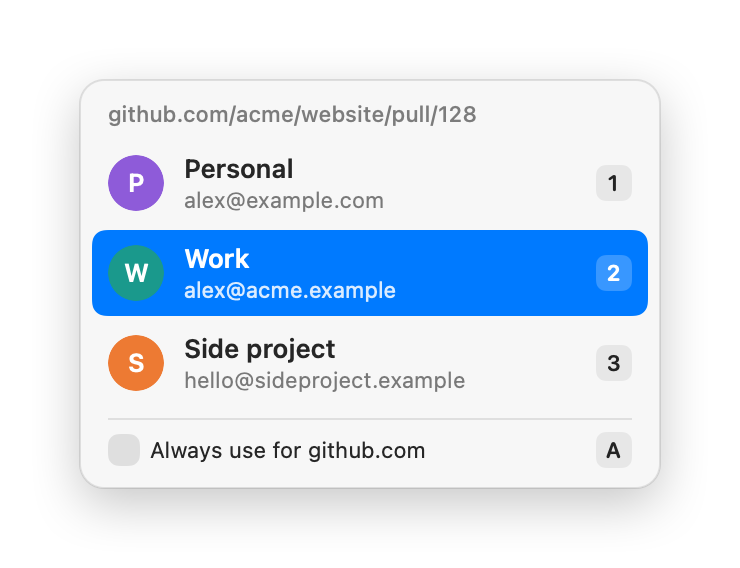
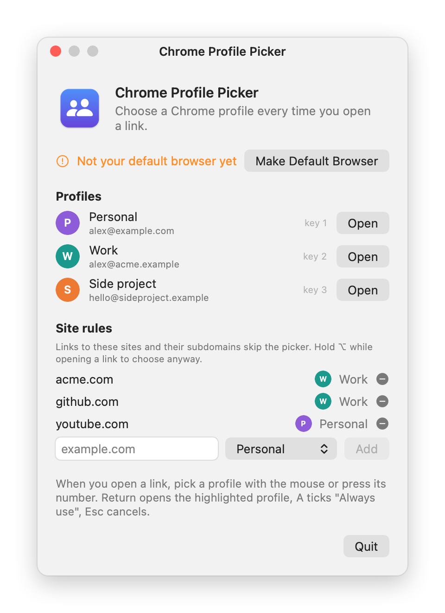

<p align="center"></p>

# Chrome Profile Picker

Choose which Chrome profile opens each link on your Mac.

Chrome Profile Picker becomes your default browser. When you click a link anywhere (Slack, Mail, Terminal, Notion, …) a small picker appears at your cursor so you can open it in the right Chrome profile. Sites that always belong to one profile can skip the picker with a rule.

<p align="center">
  <picture>
    <source media="(prefers-color-scheme: dark)" srcset="docs/picker-dark.png">
    
  </picture>
</p>

## Features

- Picker at the mouse cursor with every Chrome profile: name, email and avatar
- Keyboard friendly: `1`–`9` picks a profile, `↑`/`↓` + `Return` opens the highlighted one, `Esc` cancels
- The last used profile is preselected
- Site rules: always open `github.com` or `*.acme.com` in a specific profile
- Profiles are read straight from Chrome, so new profiles show up automatically
- Native and lightweight, no dependencies, no network access, no data collected

## Requirements

- macOS 14 Sonoma or later, Apple Silicon or Intel
- Google Chrome

## Install

### Download

1. Download `ChromeProfilePicker.zip` from the [latest release](https://github.com/stefanz92/chrome-profile-picker/releases/latest), unzip it and move **Chrome Profile Picker.app** to your Applications folder.
2. Open the app. It is not notarized by Apple, so macOS blocks it the first time: go to **System Settings → Privacy & Security**, scroll down and click **Open Anyway**. Or remove the quarantine flag in Terminal:
   ```bash
   xattr -dr com.apple.quarantine "/Applications/Chrome Profile Picker.app"
   ```
3. Click **Make Default Browser** and confirm.

### Build from source

Requires the Xcode Command Line Tools (`xcode-select --install`).

```bash
git clone https://github.com/stefanz92/chrome-profile-picker.git
cd chrome-profile-picker
./build.sh --install
```

This builds a universal app, installs it to `~/Applications` and registers it with macOS. Open it and click **Make Default Browser**.

## Usage

Click any link. The picker appears at the mouse cursor:

- click a profile, or press `1`–`9`
- `↑`/`↓` + `Return` opens the highlighted profile
- tick **Always use for <site>** (or press `A`) before picking to save a site rule
- `Esc` or clicking elsewhere cancels

With only one Chrome profile, links open straight away. Open the app again (Spotlight or Finder) to see the settings window, manage site rules or quit.

## Site rules

Links to a site with a rule skip the picker and open in that rule's profile. A rule for `acme.com` also covers every subdomain (`jira.acme.com`, …), and the most specific rule wins. Add rules from the picker or in the settings window, where you can enter a domain, `*.domain` or a full URL.

Hold `⌥` while opening a link to get the picker anyway.

<p align="center">
  <picture>
    <source media="(prefers-color-scheme: dark)" srcset="docs/settings-dark.png">
    
  </picture>
</p>

## How it works

Profiles come from Chrome's `Local State` file in `~/Library/Application Support/Google/Chrome`. To open a link in a profile, the app launches Chrome with `--profile-directory=<profile>`; a running Chrome hands that over to the right profile window.

The app has no Dock icon and stays running in the background after the first link, so the picker appears instantly. Only Google Chrome (stable) is supported.

## Uninstall

Pick another default browser in **System Settings → Desktop & Dock → Default web browser**, then delete **Chrome Profile Picker.app**.

## License

[MIT](LICENSE)
